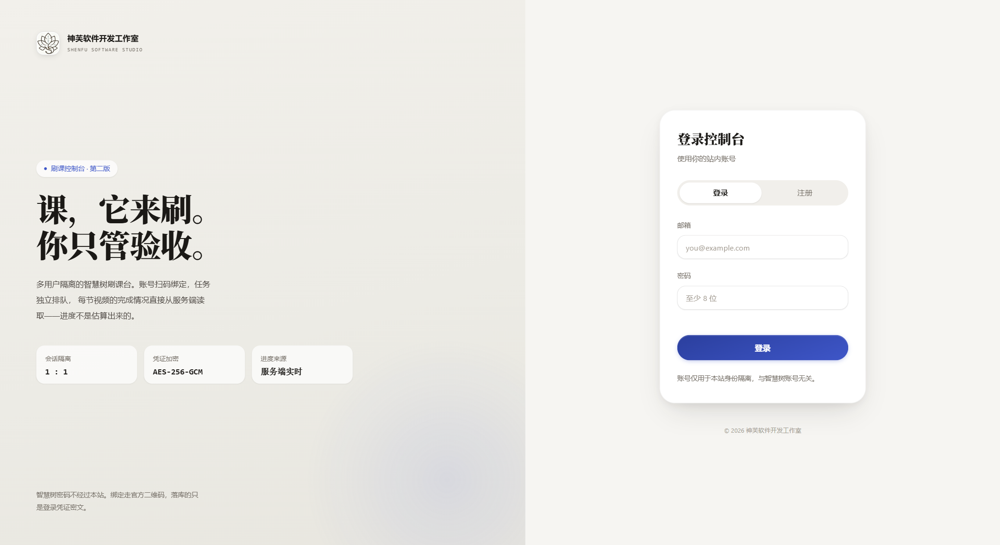
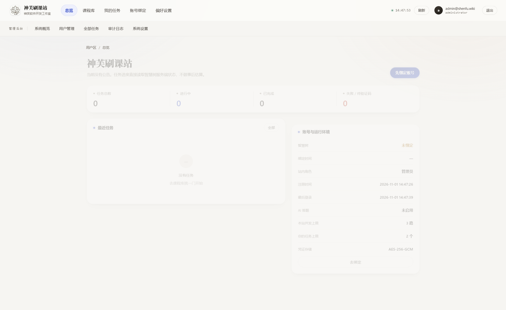
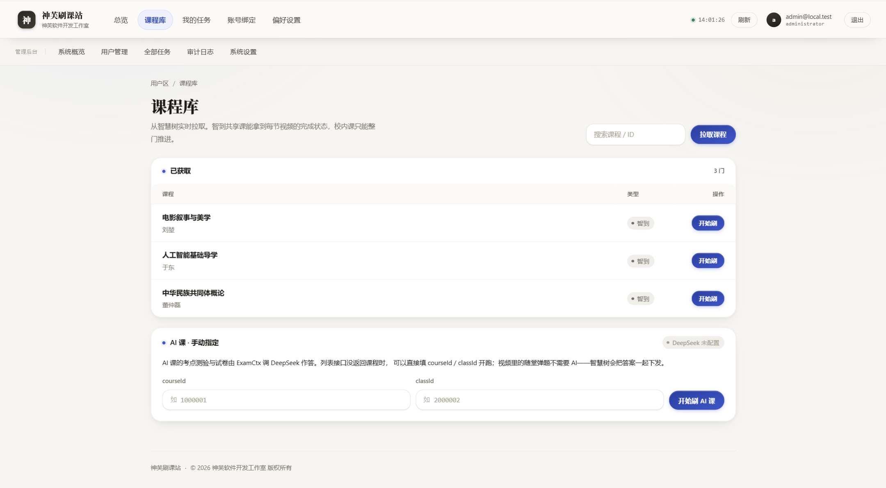

# zhidaoshuake

> 智慧树（知到）自动刷课 · 命令行 + Web 控制台 + 本地看板
> 在 [fuckZHS](https://github.com/VermiIIi0n/fuckZHS) 的基础上重写、扩展并产品化。

一套围绕智慧树学习平台的完整工具链：Python 命令行内核负责真正的刷课/签退/答题，
Flask Web 应用把它包装成多用户可管理的服务站，另附本地可视化看板、代理池维护脚本
和小程序 JS 解密工具。**点亮 Star 就是最好的支持。**

---

## 目录

- [功能](#功能)
- [目录结构](#目录结构)
- [快速开始](#快速开始)
- [命令行用法](#命令行用法)
- [配置文件](#配置文件)
- [Web 控制台](#web-控制台)
- [本地看板](#本地看板)
- [解密工具](#解密工具)
- [代理池](#代理池)
- [部署](#部署)
- [测试](#测试)
- [常见问题](#常见问题)
- [致谢与声明](#致谢与声明)

---

## 功能

**内核（CLI）**

- 支持校内学分课（hike）与共享学分课（知到）两类课程
- 二维码登录，可脱离浏览器在服务器上跑；`cookies.json` 复用短期免登录
- 视频进度推进 + 心跳上报，倍速、时长阈值、单次上限可调
- 弹题自动作答：优先本地题库，缺题时走 AI；答案经 AES 加密通道回传
- 考试环节可跳过（`--noexam`）
- `pushplus` / `bark` 推送任务结果
- 代理支持，顺手解决 Clash 之类本地代理导致的证书错误
- 树形课程列表、进度条、五级日志文件（`logs/`）

**Web 控制台（`webapp/`）**

- 多用户注册/登录，账号数据按用户隔离
- 扫码绑定智慧树账号，凭证 AES-GCM 加密落库，登录口令 PBKDF2 哈希
- 任务调度：动态限流池 + 逐视频推进 + stdout 线程路由，实时回传真实进度
- 管理后台：用户管理、系统设置、审计日志、AI 配置
- DeepSeek（OpenAI 兼容）答题通道，密钥加密存取
- 代理池按账号哈希固定分配，池空自动回退直连
- 单页前端（hash 路由），设计系统「纸与线」

**周边**

- `dashboard/`：纯标准库的本地看板，读 `logs/` 与 `qr/`，零依赖
- `decrypt/`：hike 与 studyservice-api 的 JS 混淆解密
- `tools/refresh_proxies.py`：抓取 → CONNECT 探活 → 透明代理检测 → 写回代理池

---

## 目录结构

```
.
├── main.py                  CLI 入口：参数解析、登录、课程拉取
├── fucker.py                核心：进度推进、心跳、弹题、签退、考试跳过
├── zd_utils.py              AES 密钥与 Cipher、WatchPoint、题目工具
├── sign.py                  MD5 请求签名
├── push.py                  pushplus / bark 推送
├── utils.py                 图像渲染、cookie 转换、进度条、版本比较
├── logger.py                分级日志
├── ObjDict.py               字典点访问
├── meta.json                版本 / 分支 / 作者
├── requirements.txt         Pillow、pycryptodome、requests、tiktoken、OpenAI
│
├── webapp/                  神芙刷课站（Flask 多用户平台）
│   ├── app.py               路由：用户端 + 管理后台 + 回调钩子
│   ├── runner.py            任务执行器：限流池 + 逐视频推进 + stdout 路由
│   ├── store.py             SQLite：users / zhs / tasks / audit / settings
│   ├── sechelp.py           PBKDF2 口令哈希 + AES-GCM 凭证加密
│   ├── ai.py                DeepSeek 答题器 + 配置加密存取
│   ├── browser.py           绑定/扫码相关浏览器动作
│   ├── proxypool.py         代理池分配与健康检查
│   ├── static/              单页应用（index.html / app.js / app.css / logo）
│   └── screenshots/         UI 截图
│
├── dashboard/               本地可视化看板（标准库）
│   ├── server.py            HTTP 服务，读 logs/ 与 qr/
│   └── index.html           看板页面
│
├── decrypt/                 小程序 JS 解密
│   ├── decrypt_api.py       studyservice-api 混淆还原
│   ├── decrypt_hike.py      hike 混淆还原
│   ├── main.py              批处理入口
│   └── *.zip                原始包（素材）
│
├── tools/refresh_proxies.py 远端代理池刷新（SSH + paramiko）
├── deploy/                  systemd 单元 + nginx 反代配置
├── tests/                   8 个测试脚本（冒烟 / 权限 / AI 链路）
├── images/                  README 配图
└── logs/ qr/ data/          运行时产物（已 gitignore）
```

---

## 快速开始

要求 **Python 3.10+**。

```bash
git clone https://github.com/shenfu820/-.git
cd -
python -m venv .venv
# Windows
.venv\Scripts\activate
# Linux / macOS
source .venv/bin/activate

pip install -r requirements.txt
python main.py
```

最短路径：直接 `python main.py`，按提示扫码，随后交互选择课程开刷。

---

## 命令行用法

```
python main.py [选项]
```

| 参数 | 说明 |
|---|---|
| `-c, --course` | 指定课程（可多个，支持模糊匹配） |
| `-v, --videos` | 只刷指定视频（可多个） |
| `-u, --username` | 学号 / 手机号 |
| `-p, --password` | 密码 |
| `-s, --speed` | 倍速（模拟播放速率） |
| `-t, --threshold` | 单视频完成阈值（0–1） |
| `-l, --limit` | 单次最多处理几个视频，`0` 为不限 |
| `-q, --qrlogin` | 二维码登录（当前推荐，服务器可用） |
| `-f, --fetch` | 只拉课程清单，不执行 |
| `-d, --debug` | DEBUG 模式，日志更详细 |
| `--proxy` | 指定代理 |
| `--image_path` | 二维码图片输出路径 |
| `--tree_view` | 树形展示课程 |
| `--progressbar_view` | 进度条展示 |
| `--show_in_terminal` | 终端内直接渲染二维码 |
| `-ai, --aicourse` | AI 课程处理（两个参数） |
| `--noexam` | 跳过考试 |

信息优先级：**命令行 > 配置文件 > 交互输入**。

---

## 配置文件

`config.json`（**已被 `.gitignore` 排除，不会上传**）。首次运行会生成模板：

```json
{
  "username": "",
  "password": "",
  "qrlogin": true,
  "save_cookies": true,
  "proxies": {},
  "logLevel": "INFO",
  "tree_view": true,
  "progressbar_view": true,
  "qr_extra": { "show_in_terminal": null, "ensure_unicode": false },
  "image_path": "",
  "pushplus": { "enable": false, "token": "" },
  "bark": { "enable": false, "token": "https://example.com/xxxxxxxxx" },
  "config_version": "1.4.0",
  "ai": {
    "enabled": true,
    "use_zhidao_ai": true,
    "openai": {
      "api_base": "https://api.openai.com",
      "api_key": "sk-",
      "model_name": "claude-3-5-sonnet-20240620"
    },
    "ppt_processing": {
      "provide_to_ai": false,
      "moonShot": { "base_url": "https://api.moonshot.cn/v1", "api_key": "sk-", "delete_after_convert": true }
    },
    "use_stream": true
  }
}
```

- `qrlogin`：二维码登录，优先级高于账号密码
- `save_cookies`：保存 `cookies.json`，短期内免登录
- `proxies`：`{"http": "...", "https": "..."}`，留空直连
- `logLevel`：`NOTSET` / `DEBUG` / `INFO` / `WARNING` / `ERROR` / `CRITICAL`
- `ai.*`：答题通道；`use_zhidao_ai` 走平台自带 AI，否则走上表 OpenAI 兼容端点

> 异地登录可能触发短信验证，先用浏览器正常登录一次把所在地加入白名单。

---

## Web 控制台

```bash
pip install -r webapp/requirements.txt
python webapp/app.py --port 8778
```

打开 `http://127.0.0.1:8778`。

| 模块 | 内容 |
|---|---|
| 用户端 | 登录/注册 · 账号绑定（扫码） · 课程库 · 任务列表 · 实时进度 |
| 管理后台 | 用户管理 · 系统设置 · 审计日志 · AI 配置 · 代理池状态 |
| 数据 | SQLite（`data/zhsweb.db`），含 `users` / `zhs` / `tasks` / `audit` / `settings` |
| 安全 | 口令 PBKDF2 哈希；智慧树凭证 AES-GCM 加密；`data/.devsecret` 本地密钥 |





演示数据：

```bash
python tests/seed_demo.py     # 灌 4 条演示任务 + 假绑定
```

---

## 本地看板

纯标准库，零额外依赖，适合盯着单机 CLI 任务：

```bash
python dashboard/server.py --pid <主进程PID> --port 8777
```

读取 `logs/` 与 `qr/`，在浏览器里看到当前课程、进度、错误和登录二维码。

---

## 解密工具

`decrypt/` 处理两类前端混淆：

- `decrypt_api.py` — studyservice-api 的字符串与调用还原
- `decrypt_hike.py` — hike 播放页的混淆还原

```bash
cd decrypt
python main.py          # 读取 level0.js，输出还原结果
```

工作方式是把混淆后的 `func("arg1", "arg2")` 调用批量替换为解密后的明文字符串，
便于分析播放页的校验逻辑（DevTools 检测、心跳参数等）。

---

## 代理池

```bash
python tools/refresh_proxies.py              # 默认刷新
ZHS_HOST=1.2.3.4 ZHS_PASS=xxx python tools/refresh_proxies.py
```

流程：SSH 上传采集脚本 → 多源抓候选代理 → 并发 CONNECT 探活到 `zhihuishu.com`
→ 出口 IP 与本机比对（排除透明代理）→ 复检后写入 `settings.proxy_pool`。

公开代理寿命短，建议 1–2 小时定时跑一次；池空时 runner 自动回退直连，不影响任务。

---

## 部署

```bash
cp deploy/zhsweb.service /etc/systemd/system/
cp deploy/nginx-zhsweb.conf /etc/nginx/conf.d/
systemctl daemon-reload && systemctl enable --now zhsweb
nginx -t && systemctl reload nginx
```

`deploy/nginx-zhsweb.conf` 含反向代理与 HTTPS 配置，按域名和证书路径改。

---

## 测试

```bash
python tests/full_check.py       # 全链路自检
python tests/smoke_webapp.py     # Web 冒烟（不碰真实账号）
python tests/role_gate.py        # 角色权限矩阵
python tests/ai_gate.py          # /admin 准入 + AI 接口权限
python tests/ai_mock.py          # 假 OpenAI 端点跑通答题
python tests/popup_answer.py     # 弹题两条分支
python tests/probe_ai.py         # AI 端点探活
```

---

## 常见问题

**登录报错 / 提示短信验证**
用浏览器正常登录一次，让当前网络进入平台白名单，再回来扫码。

**Clash / 本地代理导致 SSL 证书错误**
在 `config.json` 的 `proxies` 里显式填写本地代理地址，或直连运行。

**进度不涨 / 卡在某个视频**
`--debug` 看日志，确认心跳是否被拒；必要时降低倍速、调小 `--threshold`。

**二维码不显示**
`--show_in_terminal` 打开终端渲染，或 `--image_path` 指定图片落盘路径。

---

## 致谢与声明

- 原始项目：[VermiIIi0n/fuckZHS](https://github.com/VermiIIi0n/fuckZHS)，`push.py` 源自 Vincent Young
- 本项目在其基础上重构内核，并新增 `webapp` / `dashboard` / `decrypt` / `tools` / `deploy`

仅供个人学习与技术研究使用。请遵守所在学校与平台的规章制度，使用产生的一切后果由使用者自行承担。

如果这个项目帮你省下了几个通宵，点个 ★ 就够了。

