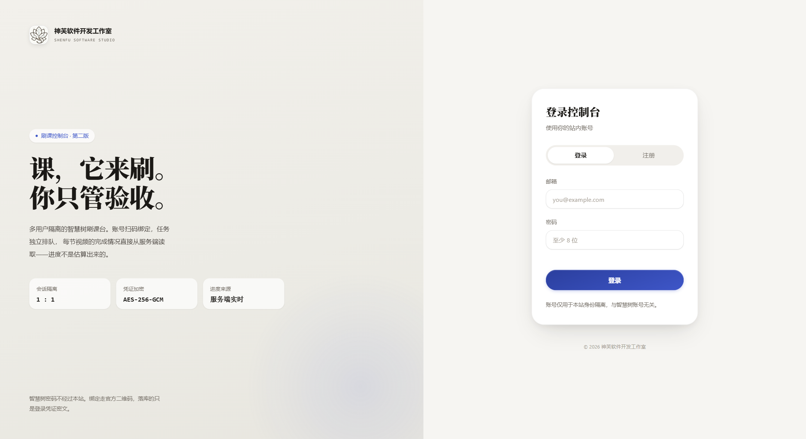
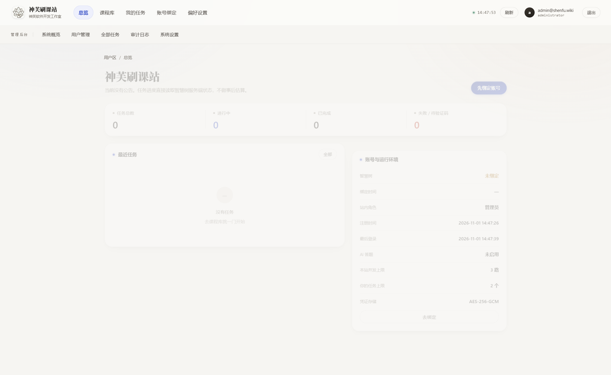
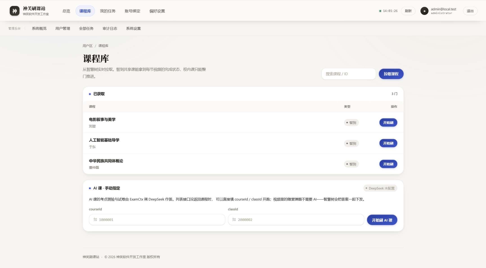
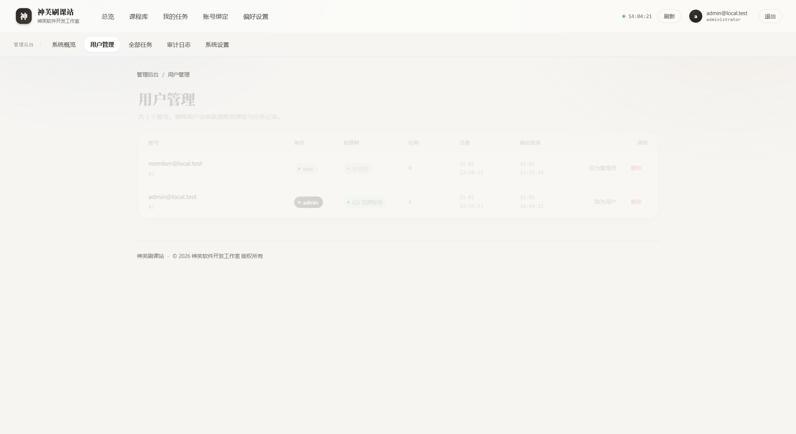
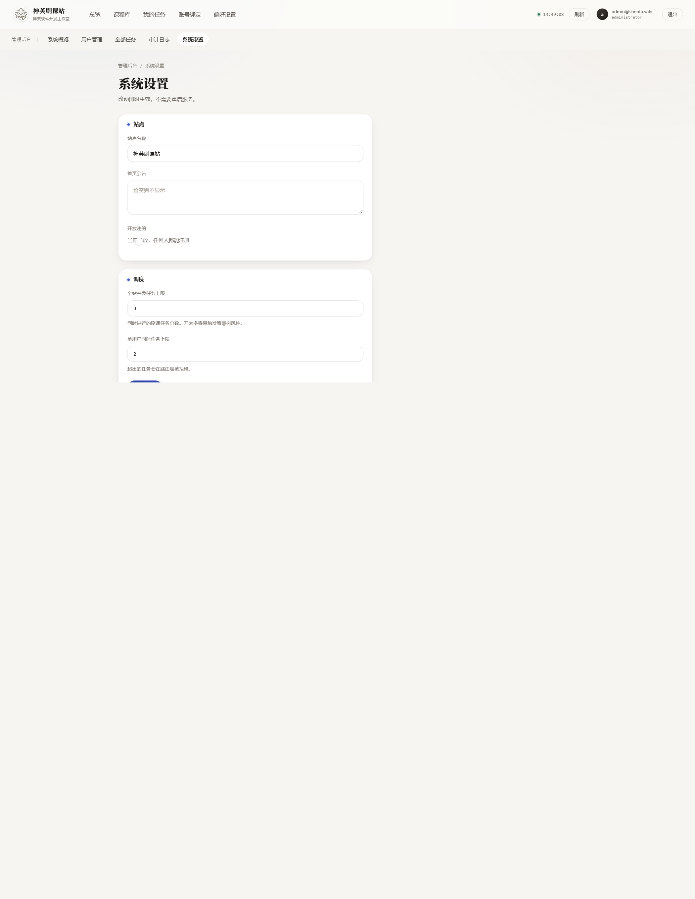

# 神芙刷课站

> 神芙软件开发工作室 · 多用户刷课控制台
> © 2026 神芙软件开发工作室 版权所有

把单机 CLI 包成多人可用的 Web 产品：**账号隔离 → 二维码绑定 → 任务调度 → 真实进度 → 管理后台**。

界面是单页应用：左侧固定导航 + 顶栏 + 视图区，用户区五个页面，管理后台五个页面，hash 路由。







## 目录

```
webapp/
  app.py               Flask 路由（用户端 + 管理后台 + 回调钩子）
  runner.py            任务执行器：动态限流池 + 逐视频推进 + stdout 线程路由
  store.py             SQLite：users / zhs / tasks / audit / settings
  sechelp.py           PBKDF2 口令哈希 + AES-GCM 凭证加密
  ai.py                DeepSeek 答题器（OpenAI 兼容）+ 配置加密存取
  static/
    index.html         应用外壳
    app.css            设计系统 v4「纸与线」：浅纸底 / 宋体标题 / 朱红点缀 / 细线分区
    app.js             运行时：路由 / 视图 / 事件委托
  screenshots/         UI 截图
deploy/
  zhsweb.service       systemd 单元
  nginx-zhsweb.conf    nginx 反代 + HTTPS
tests/
  smoke_webapp.py      链路冒烟（不碰真实账号）
  role_gate.py         角色权限矩阵验证
  seed_demo.py         灌演示数据（截图/演示用）
  ai_gate.py           /admin 页面准入 + AI 接口权限
  ai_mock.py           假 OpenAI 端点跑通答题全链路
  popup_answer.py      弹题两条分支（下发答案 / 缺答案走 AI）
```

## 答题能力边界（先看这个）

## 图标

原图 `static/logo-source.png`（644×648，含徽标 + 「神芙」+ 工作室全称的完整版面）。页面各处使用的是从原图裁出的**徽标部分**（莲花 + 电路线条，304×301），因为完整版面缩到 32px 时文字会糊成一团灰块。

| 文件 | 尺寸 | 用途 |
|---|---|---|
| `favicon.ico` | 16/32/48/64 多尺寸 | 浏览器标签页 |
| `logo-64.png` | 64 | 高分屏标签页 |
| `logo-128.png` | 128 | 顶栏与登录页（CSS 缩到 34/40px 显示） |
| `apple-touch-icon.png` | 180 | iOS 添加到主屏 |
| `logo-256/512.png` | 256/512 | 分享卡片、PWA 图标备用 |

重新生成：改完 `logo-source.png` 后重跑裁切脚本即可，裁切区域是原图 `y 39–340`、`x 162–466`。

## 界面（v5「柔润」）

明确避开深色霓虹 + 玻璃面板 + 渐变大标题那一套 AI 生成界面的固定长相，也避开方角硬边的「报表感」，走柔和精致路线：

| 决定 | 理由 |
|---|---|
| 大圆角成套：6 / 10 / 14 / 20 / 26 / 全圆 | 圆角半径统一成一套，界面才像被设计过，不是随手写的 |
| 多层柔和投影（3 档）+ 1px 内描边 | 用光影分层替代硬边框；卡片悬停时投影加深并轻抬 |
| 背景两团极淡径向光晕 | 纯色底会发闷，加一点空气感 |
| 宋体做标题、无衬线做正文 | 中文标题有印刷物重量，避免全站一种字体 |
| 只有一个强调色（靛蓝 `#3e56c8`） | 强调色越少越像人做的；状态色只出现在数据里 |
| 顶栏半透明毛玻璃 + 滚动浮起 | 滚动 6px 后加阴影，层次跟着动 |
| 数字用 tabular-nums + 滚数动画 | 纵向对齐不跳动，进页面时从 0 滚到目标值 |

**动效清单**（统一走 `--ease` / `--ease-out` / `--spring` 三条曲线）：

页面切换淡入上移 · 卡片错峰升起 · 表格行逐行出现 · 状态胶囊弹入 · 进度条渐变 + 流动高光 · 按钮悬停抬升 / 按下回缩 · 输入框聚焦柔光晕 · 导航胶囊切换 · 二维码弹出 · Toast 侧滑弹入 · 运行中指示灯呼吸 · 登录页背景光斑漂浮 · 二级导航下拉展开 · 骨架屏扫光。全部遵循 `prefers-reduced-motion`——系统开了「减少动态效果」会整体关掉。

**可验证指标**：全站文本节点对比度扫描 **48 个节点，0 个低于 WCAG AA（4.5:1）**。无外部字体、无 CDN、无图片素材，断网也能完整渲染。

## 单 IP 风控对抗

智慧树的风控不只看请求频率，更看「这些账号是不是同一个人」。原版 Fucker 给所有会话写死同一套指纹（Chrome 100 / macOS / `en-GB`），同一个 IP 上几十个「不同用户」长得一模一样，是最容易被关联的特征。

| 措施 | 做法 |
|---|---|
| 每账号独立浏览器指纹 | 20 套真实桌面指纹（Chrome 120–133 / Edge / Firefox / Safari，跨 Windows 与 macOS），按账号邮箱 SHA-256 取模稳定分配 |
| 每账号独立倍速 | 1.2–1.8 倍随机但固定，避免全站整齐划一地跑 1.5x |
| 播放节奏抖动 | 循环 `sleep(1)` 改为 `1 + random()*0.45` 秒，贴近真实网络抖动 |
| 任务启动错峰 | 开跑前在 `0 ~ stagger_max` 秒内随机等待，避免整批任务同一秒打接口 |
| 撞码全站冷却 | 任意任务遇到 `code -12`，所有待启动任务暂停 `captcha_cooldown` 分钟再开，防止连环踩雷 |
| 状态可见 | 任务出现 `throttled`（风控冷却）状态，设置页实时显示近一小时撞码次数与剩余冷却 |

同一账号的指纹与倍速**跨次运行保持一致**（用邮箱做种子），不会出现「同一个号今天 Chrome 明天 Safari」这种自相矛盾的情况。

两个可调参数在「系统设置 → 单 IP 风控」：`captcha_cooldown`（0–240 分钟）、`stagger_max`（0–600 秒）。填 0 即关闭对应机制。

## 容量参考

| 线程数 | 进程内存 | 说明 |
|---|---|---|
| 200 | 18.9 MB | 每线程约 55 KB（Windows 实测） |
| 500 | 34.0 MB | |
| 1000 | 64.0 MB | |
| 2000 | 124.2 MB | 纯排队，不占网络 |

每个活跃任务每秒只做一次 `sleep` 空转，每 30 秒发一次进度上报，100 个任务的出口带宽不到 1 Mbps。**服务器不是瓶颈，同 IP 的风控容忍度才是。**

## 功能验收（全部实测通过）

| 项 | 结果 |
|---|---|
| 注册 → 改密码 → 旧密码失效 → 新密码可登录 | 401 / 200 符合预期 |
| 管理员提权、降级、删用户 | 200；删最后一个管理员被拒 400 |
| 建任务 → 运行 → 停止 → 落 stopped | 全链路通，`signaled: true` |
| 系统设置热更新（并发 3→5→3） | 即时生效，无需重启 |
| AI 配置保存 + base 规范化 | `…/v1` 自动剥成 `…` |
| 无密钥时点测试 | 明确报错，不静默失败 |
| 未绑定账号拉课程 / 建任务 | 400 带中文原因 |
| 审计留痕 | 36 条，含 create/stop/delete/ai_config |
| 非管理员访问后台 | 页面 302、接口 403、侧栏不渲染、手敲 hash 被弹回 |

| 题型 | 是否自动 | 靠什么 |
|---|---|---|
| 视频内随堂弹题 | **自动** | 智慧树下发题目时把正确答案一起给了（`questionOptions[].result == '1'`），直接选出来提交，**不消耗任何 token** |
| 弹题但没下发答案 | 自动（需配 AI） | `SmartFucker.answerZhidao` 兜底问 DeepSeek，二次校验 id 必须在选项内 |
| AI 课的考点测验 / 试卷 | 自动（需配 AI） | `fuckAiCourse` → `ExamCtx` 逐题生成 prompt，调 DeepSeek 作答后提交 |
| 普通智到共享课的章节测验 / 期末考 | **没有实现** | 项目里没有对应接口调用；`grep exam` 只命中 AI 课与弹题 |
| 校内课（hike） | 只能整课推进 | 无逐视频粒度，进度显示为不确定 |

一句话：**视频里的题会自己做，AI 课的卷子会自己做，独立期末考试这套代码没有**。

## AI 答题（DeepSeek）

管理员在「系统设置 → AI 答题」里填 Base / Model / Key，密钥 AES-GCM 加密落库，接口只回传尾号。

```
Base : https://api.deepseek.com     ← 不要带 /v1，程序会自己拼（带 /v1 会被自动剥掉）
Model: deepseek-chat                ← 快而便宜；deepseek-reasoner 更强但更慢
Key  : sk-xxxx
```

点「连通性测试」会真发一道小题（下列哪个数是偶数）验证 key / 模型 / 网络，返回耗时。测试不过就直接看错误信息，不会污染任务。

答题器要点：

- 走 `requests.Session()` 且 `trust_env = False`——否则系统代理会把调用吞掉挂到超时（踩过）。
- 解析兼容 ```answer 块、裸 JSON、`{"answer":[id]}`、纯 id；模型胡言乱语时挖不出 id 就判失败，不瞎提交。
- 只接受真实存在于选项里的 id，防幻觉。

## 本地跑

```bash
python -m venv .venv
.venv/bin/pip install -r webapp/requirements.txt      # Windows: .venv\Scripts\pip
.venv/bin/python webapp/app.py --port 8778
# http://127.0.0.1:8778/
```

首次启动生成 `data/zhsweb.db`。**第一个注册的账号自动成为管理员**，之后注册的都是普通用户。

想先看界面长什么样：

```bash
.venv/bin/python tests/seed_demo.py     # 灌 4 条演示任务 + 假绑定
```

## 信息架构

| 用户区 | 内容 |
|---|---|
| 总览 | 四段指标带、最近任务、账号状态 |
| 课程库 | 实时拉取智慧树课程，搜索过滤，一键开刷 |
| 我的任务 | 状态筛选、真实进度条、内联日志、停止/重跑 |
| 账号绑定 | 二维码授权、解绑、站内身份 |
| 偏好设置 | 修改密码 |

| 管理后台 | 内容 |
|---|---|
| 系统概览 | 六段指标带、最近任务、最近活动、运行时长 |
| 用户管理 | 角色升降、绑定状态、任务计数、删除 |
| 全部任务 | 全站任务流水、强制终止 |
| 审计日志 | 登录/绑定/建任务/改配置等全量操作 |
| 系统设置 | 站名、公告、开放注册开关、并发上限 |

## 权限矩阵（已验证）

| 接口 | 普通用户 | 管理员 |
|---|---|---|
| `/api/me`、`/api/tasks`、`/api/courses`、`/api/zhs/*` | 200 | 200 |
| `/api/admin/overview`、`users`、`tasks`、`audit`、`settings` | **403** | 200 |
| `/api/admin/ai`、`/api/admin/ai/test` | **403** | 200 |
| `GET /admin` 页面入口 | **302 → /?denied=admin** | 200 |

管理后台是三层拦截，缺一层都能被绕过：

1. **页面入口**：`GET /admin` 直接查 session 角色，非管理员 302 打回首页。
2. **接口**：每个 `/api/admin/*` 单独 `@need_admin`，403。
3. **界面**：`renderNav()` 按 `role` 过滤分组，hash 路由再守一次——非管理员敲 `#/admin/users` 会被弹回总览并提示。

普通用户的侧栏根本不渲染「管理后台」分组。

## 三个设计约束

1. **只能单 worker**（`-w 1 --threads 32`）。
   任务注册表和二维码会话在进程内存里。多 worker 会变成「A 的二维码 B 查不到」「任务一直排队」。要横向扩就得把这两块搬到 Redis。
2. **进度是真数字**。
   智到课用 `getZhidaoContext()` 读每节视频的 `watchState` 拿到 total/done，再逐节调 `fuckZhidaoVideo()`，每完成一节 `done += 1`。校内课拿不到逐节粒度，显示为不确定进度条——**不编数字**。
3. **并发上限可热改**。
   `runner._Pool` 每次获取槽位时读一次 `settings.max_concurrent`，所以后台改配置即时生效，不用重启。

## 安全

- 智慧树密码**不经过本站**；绑定只走官方二维码。
- 凭证 AES-GCM 加密存库，密钥由 `ZHS_SECRET` 派生。**换密钥 = 全员重新绑定。**
- 口令 PBKDF2-SHA256 20 万轮，逐用户加盐。
- 会话为 Flask 签名 cookie；线上必须 HTTPS。
- 管理操作全部写入审计表（含 IP），不可通过 UI 删除。

生成密钥：

```bash
python3 -c "import secrets;print(secrets.token_hex(32))"
```

## 部署

```bash
sudo useradd -r -s /bin/false zhs
sudo mkdir -p /opt/zhs && sudo chown zhs:zhs /opt/zhs
# 仓库放进 /opt/zhs
cd /opt/zhs && sudo -u zhs python3 -m venv .venv
sudo -u zhs .venv/bin/pip install -r webapp/requirements.txt

sudo cp deploy/zhsweb.service /etc/systemd/system/
sudo vim /etc/systemd/system/zhsweb.service    # 改 ZHS_SECRET
sudo systemctl daemon-reload && sudo systemctl enable --now zhsweb

sudo cp deploy/nginx-zhsweb.conf /etc/nginx/sites-available/zhsweb
sudo ln -s /etc/nginx/sites-available/zhsweb /etc/nginx/sites-enabled/
sudo nginx -t && sudo systemctl reload nginx
sudo certbot --nginx -d zhs.example.com
```

## 已知限制

| 限制 | 说明 |
|---|---|
| 验证码 | 任务置 `need_captcha` 并停下，需人工介入，不硬闯 |
| 停止延迟 | 停止信号在视频之间生效，单节提交中不会立刻中断 |
| 重启恢复 | 重启时 `running` 全标 `interrupted`，不自动续跑 |
| 课程缓存 | 每次拉取都同步打智慧树接口，无缓存池 |
| 密码找回 | 无邮件服务，忘记密码只能改库 |